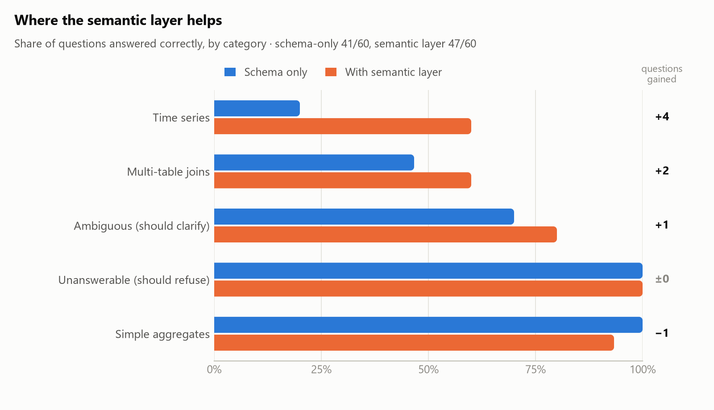
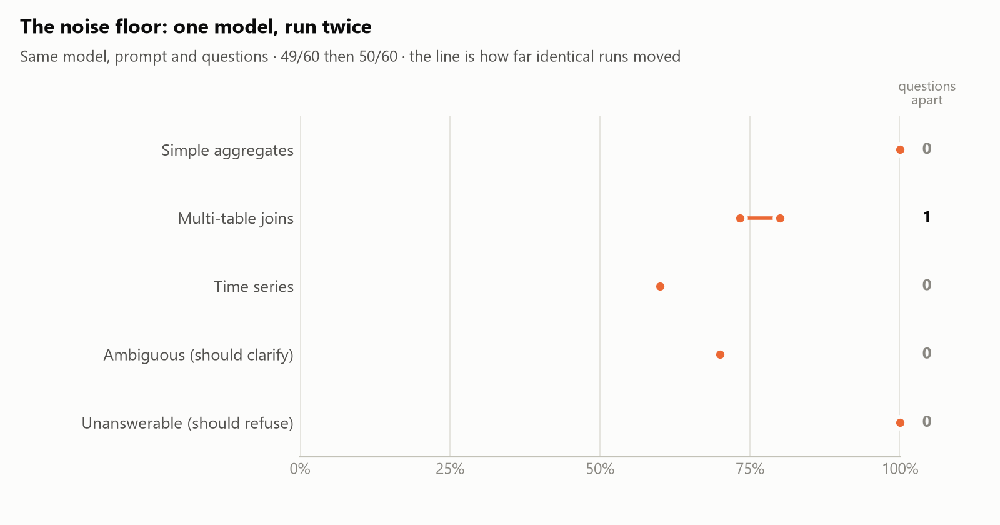
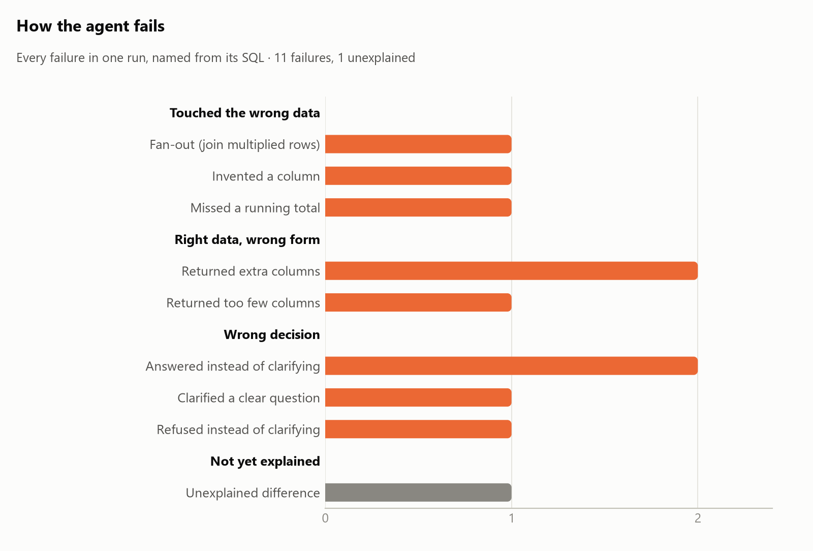
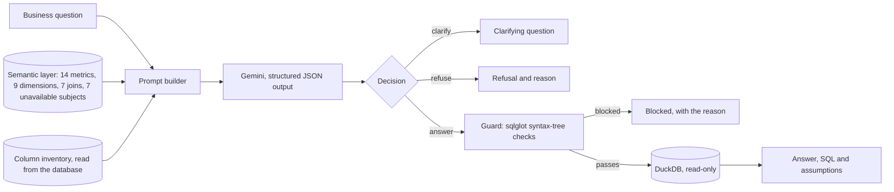

# CANDOR

**An analytics agent that would rather say "I don't know" than hand you a wrong number.**

Ask a business question in plain English. Get the SQL, the answer, and the assumptions behind
it — or a clarifying question, or a refusal with the reason.

[](https://www.python.org/)
[](https://docs.getdbt.com/)
[](https://duckdb.org/)
[](#results)
[](LICENSE)

---

## The problem

Every company has the same bottleneck. The people who need answers can't write SQL; the people
who can are a small team with a queue. A question becomes a ticket, the ticket takes three
days, and the meeting it was for already happened.

The obvious fix is to put a language model in the middle. Most attempts fail — and they fail in
a way that makes them worse than useless.

**They don't fail loudly. They fail silently.** The model returns a confident, cleanly
formatted number that happens to be wrong, and the person asking has no way to tell, because
not knowing SQL was the whole reason they asked.

### Here is that failure, measured

Two queries against this database. Both run. Neither errors. Neither warns.

| | |
|---|---|
| Total order value, computed correctly | **R$15,843,550** |
| Same figure, after one careless join | **R$20,304,560** |
| Overcounted | **R$4,461,010 — 28.2%** |

The second query joins orders to order items and then sums an order-level column, so each order
is counted once per item it contains. The row count inflates by only 14.2%, but the money
inflates by 28.2%: orders with more items are also the expensive ones, so the multiplication
lands hardest where it costs most. **You cannot estimate this error from the row counts.**

---

## Results

60 questions with verified answers, in five categories. The same model and the same
instructions, run twice: once given only the table and column names, once given the semantic
layer as well.

<picture>
  <source media="(prefers-color-scheme: dark)" srcset="docs/img/benchmark-by-category-dark.png">
  
</picture>

| Category | Schema only | Semantic layer | Change |
|---|---:|---:|---:|
| Time series | 2/10 | 6/10 | +4 |
| Multi-table joins | 7/15 | 9/15 | +2 |
| Ambiguous — should clarify | 7/10 | 8/10 | +1 |
| Unanswerable — should refuse | 10/10 | 10/10 | 0 |
| Simple aggregates | 15/15 | 14/15 | −1 |
| **Overall** | **41/60 — 68.3%** | **47/60 — 78.3%** | **+10.0 points** |

`gemini-3.1-flash-lite`, Google AI Studio free tier, November 2026. Both runs used the same
prompt version, before the prompt change described in *What was learned*. Scored by executing
both the agent's SQL and the verified SQL and comparing the results, not the query text.

### Is ten points real? The noise floor, measured

A gap between two runs means nothing until you know how far two *identical* runs drift. So the
same model was run twice on the same questions with the same prompt:

<picture>
  <source media="(prefers-color-scheme: dark)" srcset="docs/img/noise-floor-dark.png">
  
</picture>

**49/60, then 50/60. The two runs agreed on pass or fail for 59 of the 60 questions.** The noise
floor is one question. That decides what can be claimed:

| Claim | Gap | Verdict |
|---|---:|---|
| The semantic layer beats schema-only | 6 questions | **Holds** — six times the noise floor |
| `gemini-3.5-flash-lite` is weaker than `3.1-flash-lite` | 5 questions | **Holds, cautiously** — five times the noise floor, but 3.5 ran once |
| Listing every column in the prompt helped | 2 questions | **Marginal** — twice the noise floor, measured once |

One pair of runs is one measurement of the noise, not the last word on it. The categories that
did not move at all — simple aggregates, time series, ambiguous, unanswerable — are what make the
per-category results worth reading.

---

## What was learned

### 1. The semantic layer changes which data the model touches, not how it presents it

The control run separates two kinds of mistake:

| The semantic layer fixed it | It happened with and without the semantic layer |
|---|---|
| Swapping `item_total` (includes freight) for `item_price` | Returning extra columns nobody asked for |
| Grouping by `month_name` — "April" across three years | A proportion where a percentage was asked for |
| Dropping a required filter | A column labelled `revenue` holding item revenue |
| Inventing a column that does not exist | No column label at all |

The left column is choices about **which data to touch**, and better context fixed them. The
right column is choices about **shape, naming and form**, and better context did not touch them.
A semantic layer is worth building to stop wrong numbers. It is not a substitute for checking how
a right number is presented.

### 2. Targeted instructions fixed what they named — and broke two other things

Two of those form errors were then attacked directly: one sentence telling the model that metric
names are definitions, not columns, and one question reworded from "share" to "percentage".

Comparing the run before the change against **both** runs after it:

| | Questions |
|---|---|
| Fixed in both repeat runs | Q014, Q019, Q023, Q025, Q038 |
| **Newly broken in both repeat runs** | **Q037, Q046** |
| Failed in every run, before and after | Q017, Q027, Q028, Q033, Q034, Q036, Q045, Q050 |

Both targeted errors were fixed. And the same edit made the model clarify an answerable
time-series question and refuse an ambiguous one it had previously clarified. Net, five fixed and
two broken.

**A prompt change is not a local fix.** It is visible here only because the change was measured
against two independent runs — with one run, the two new failures would have looked like noise
and the five fixes would have looked like luck.

The bottom row matters too: **eight questions fail on every run.** The remaining failures are
not random. They are a stable set, worth fixing one at a time.

### 3. The refusals were never the semantic layer's doing

The prediction going into the control run was that without the semantic layer — no list of
unavailable data, no definitions — the agent would start inventing answers to questions the data
cannot support. **It refused all ten anyway**, profit margin included, on a dataset with no cost
data.

The refusals come from the decision framework: the model is offered ANSWER, CLARIFY and REFUSE
as equally legitimate outcomes, and that alone was enough. It is a prompt design, not a data
asset, and the credit belongs there. The prediction was written down before the run, which is
what makes the failure worth reporting.

### 4. The confident wrong answer, reproduced on demand

Without the semantic layer, asked which seller earned the most from delivered items:

| | |
|---|---|
| Correct — `item_price` | R$226,987.93 |
| Schema-only — `item_total`, which includes freight | R$247,007.06 |
| **Overstated by** | **8.8%** |

No error, no warning, a plausible column name and a plausible number. A second question dropped
the "delivered" filter and overstated by 2.1%. With the semantic layer, both were right.

### 5. Fan-out survives every condition — and its cost depends on the column

The agent still joins order items and then averages an order-level column, in every run, with and
without the semantic layer. On average delivery time by seller state, that shifts each state's
figure by hundredths of a day. On order value, the same mistake costs 28% — the figure this README
opens with.

**The bug is identical. Only the column decides what it costs**, because the damage depends on
whether orders with more items differ on the measured column. That is a reason to catch fan-out
mechanically rather than hope a prompt prevents it, which is the next piece of work.

### How the agent fails

<picture>
  <source media="(prefers-color-scheme: dark)" srcset="docs/img/failure-taxonomy-dark.png">
  
</picture>

Every failure is named by a rule that reads its SQL as a syntax tree. **10 of 11 are explained;
1 is not**, and that residual is reported rather than absorbed into a neighbouring category.
Every rule was written from a failure that actually happened, never from imagining one.

The two repeat runs agreed on *which* questions failed, but not always on *how*: Q028 invented a
column in one run and fanned out in the other. A taxonomy describes one run; the pass-or-fail
result is the more stable of the two.

---

## How it works



**The decision is structured, not parsed.** The model returns a validated JSON object with a
required `decision` field. A response that is neither an answer, a question, nor a refusal is
rejected before anything runs.

**The semantic layer is sent whole.** It is about 2,840 tokens, small enough that retrieval
would add a way to fail — the agent missing a metric because a search did not surface it —
without removing one.

**The guard judges the syntax tree, not the text.** Searching SQL for the word `drop` blocks
the legitimate question "how many orders had a price drop?" and is defeated by a comment. Four
layers, and they are not the same kind of thing:

| Layer | Kind |
|---|---|
| Read-only database connection | Guarantee — enforced by the engine |
| One statement, SELECT only | Allowlist |
| Tables must be declared in the semantic layer | Allowlist |
| File- and network-reading functions refused | Denylist — best effort, never complete |

"Read-only" protects the data, not what a query can *read*: `select read_text('C:/secrets.txt')`
writes nothing and leaks a file. That is why the last layer exists, and why it is listed last.
37 test cases prove the guard blocks what it must **and** lets real queries through — a guard
that blocks everything passes every attack test and is useless.

### The data layer

```
raw (9 tables)  →  staging (9 views)  →  marts (6 tables)
     CSV              typed, renamed,        star schema
                      deduplicated
```

**Dimensions** — `dim_customers`, `dim_products`, `dim_sellers`, `dim_dates`
**Facts** — `fct_orders` (99,441 rows), `fct_order_items` (112,650 rows)

71 dbt nodes and 55 data-quality tests, all passing, including referential-integrity checks and
a reconciliation test that computes total item value two independent ways and requires them to
agree to the cent.

[Olist Brazilian E-Commerce](https://www.kaggle.com/datasets/olistbr/brazilian-ecommerce) —
about 100,000 real orders across nine related tables. Public, messy, and complex enough that the
questions need real joins.

---

## What the data was hiding

### A customer is not a customer

The source `customers` table has **99,441 rows — exactly the order count.** Olist issues a new
customer ID for every order. The person is `customer_unique_id`, and there are **96,096** of
them. Build on the wrong column and "orders per customer" is 1.00 — reasonable-looking and
meaningless.

### A review can belong to several orders

A uniqueness test on `review_id` failed: **789 IDs appear more than once**, each with identical
score and text, attached to different orders. That is one review covering a basket split across
sellers. Deduplicating would have destroyed real links, so the identity is the **(review, order)
pair**, asserted by its own test.

### 623 uncategorised products were two problems

**610** genuinely have no category. **13** have a good Portuguese category missing from Olist's
translation table. Only the first group is unknown; the second was losing a label it already had.

### Eight orders claim delivery with no delivery date

96,478 orders are marked delivered; **96,470** have a delivery date. Those eight get an *empty*
delivery time, not zero — zero would drag every average down with eight impossible same-day
deliveries. Late is null, not false, for undelivered orders, or a warehouse that stopped shipping
entirely would show a perfect record.

---

## Checking the checks

Every measuring instrument in this project was wrong at least once, and each one was caught by
testing it rather than reading it.

| Instrument | What was wrong | Which way it lied |
|---|---|---|
| A verification count | Gave the same number whether a fix worked or not | Hid a failure |
| The scorer | Forgave a ranking returned in the wrong order | **Inflated the score** |
| The benchmark's resume | Treated a failed API call as a finished question | Shrank the denominator, silently |
| 23 of the 60 answer keys | Demanded columns their questions never asked for | Deflated the score by 13 questions |
| One answer key | Counted a late order that was never delivered | Marked the agent wrong when it was right |
| The repeat run | Resumed a finished file, so the "repeat" was the original run | Produced a false noise floor and a false finding — caught, and both are corrected above |

The last row is the agent catching its examiner: asked how many **delivered** orders arrived
late, it answered 7,826 against an answer key of 7,827. The answer key was wrong.

**The answer key is a suspect too.** A benchmark that treats its own answers as beyond question
is measuring agreement with its author.

---

## Business numbers

Computed from the built models. **Every figure states its scope**, because "filtered where
relevant" is how a correct number gets read as a different one.

| Metric | All orders | Delivered orders |
|---|---:|---:|
| Orders | 99,441 | 96,478 |
| Total order value | R$15,843,550 | R$15,419,773.75 |
| — items | R$13,591,640 | R$13,221,498.11 |
| — freight | R$2,251,910 | R$2,198,275.64 |
| Average order value | — | R$159.83 |
| Average review score | 4.087 *(orders with a review)* | 4.156 |
| Average delivery time | — | 12.5 days |
| Late deliveries | — | 7,826 of 96,470 with a date — 8.1% |
| Cancelled or unavailable | 1,234 | — |
| Distinct customers | 96,096 | — |
| Repeat customers | 2,997 — 3.1% | — |
| Orders with no line items | 775 | — |

---

## Limitations

Stated plainly, because a reader should not have to discover them.

- **The noise floor comes from one pair of runs** — one question apart, 59 of 60 questions in
  agreement. Schema-only and `3.5-flash-lite` ran once each.
- **One model family.** Every model was a Gemini model on the free tier. `gemini-4-hydrogen`
  answered 16 of 60 questions across several evenings before its daily quota and repeated
  "high demand" errors stopped it; it is excluded from the comparison rather than scored on
  the questions it happened to reach.
- **The questions and their answers were written by the same person** who built the semantic
  layer, so they are not a neutral sample. 28 cross-checks compute key answers two independent
  ways; the remaining answers, including every ranking, were checked by hand.
- **Preview and "latest" models were avoided** because they change without notice, which would
  make a result impossible to reproduce. Every result records its model and date.
- **The semantic layer does not prevent fan-out**, and the prompt change that fixed two form
  errors introduced two decision errors. Both are open.

---

## Running it

```bash
git clone https://github.com/<Yesha-Modi>/candor.git
cd candor

py -3.13 -m venv .venv
.\.venv\Scripts\Activate.ps1        # Windows
# source .venv/bin/activate         # macOS / Linux

pip install -r requirements.txt
```

Download the [Olist dataset](https://www.kaggle.com/datasets/olistbr/brazilian-ecommerce) and
extract the nine CSVs into `data/raw/`. Then build and check the data:

```bash
python -m src.ingest              # CSVs into DuckDB
cd transform
dbt seed                          # reference overrides
dbt build                         # all models, all 55 tests
cd ..
python -m src.profile             # 16 data-quality checks
python -m eval.cross_check        # each gold answer computed two independent ways
```

Ask a question — this needs a free [Google AI Studio](https://aistudio.google.com) key in a
`.env` file as `GEMINI_API_KEY=...`:

```bash
python -m agent.ask "Which product category generated the most revenue from item sales?"
```

Run and score the benchmark:

```bash
python -m eval.check_guard        # 37 guard cases
python -m eval.check_taxonomy     # failure classifier against real failures
python -m eval.benchmark --mode semantic
python -m eval.benchmark --mode schema
python -m eval.compare
python -m eval.taxonomy results/semantic_gemini_gemini-3.1-flash-lite.jsonl
python -m eval.make_charts        # redraw the charts in this README
```

A benchmark run resumes where it stopped, so an interruption costs nothing.

---

## Stack

Everything is free. There is no paid tier anywhere in the project.

| Layer | Tool |
|---|---|
| Warehouse | DuckDB |
| Transformation and tests | dbt Core |
| Language | Python 3.13 |
| Model | Google Gemini, free tier, via `google-genai` |
| Structured output | Pydantic |
| SQL safety | sqlglot |
| Charts | matplotlib |

---

## Repository layout

```
candor/
├── agent/
│   ├── ask.py              ask one question from the command line
│   ├── prompt.py           build the prompt: semantic or schema-only
│   ├── provider.py         the model call: timeout, retries, token budget
│   ├── guard.py            syntax-tree checks before any SQL runs
│   └── schema.py           the structured response
├── semantic/
│   └── semantic_layer.yaml metrics, dimensions, joins, unavailable subjects
├── eval/
│   ├── gold_questions.yaml 60 questions with verified SQL
│   ├── benchmark.py        run the questions, resumably
│   ├── score.py            compare results, judge labels
│   ├── taxonomy.py         name every failure from its SQL
│   ├── compare.py          every run side by side
│   ├── make_charts.py      the charts in this README
│   └── check_*.py          tests for the guard and the classifier
├── results/                every benchmark run, committed as evidence
├── checks/                 saved one-off verification queries
├── src/                    ingestion, profiling, ad-hoc SQL
├── transform/              dbt project: staging, marts, tests, seeds
└── docs/img/               generated charts
```

---

## What comes next

- **Give the guard the column list.** It already knows which tables exist. Knowing the columns
  turns a model that invents `seller_id` or selects a metric's name into a clear refusal
  instead of a database error.
- **Catch fan-out in the guard**, where it can be checked, rather than in the prompt, where it
  can only be asked for.
- **Repeat every condition three times** and report ranges, so per-category differences can be
  claimed rather than only the overall one.
- **An interface** in front of the command line.

---

## License

[MIT](LICENSE)